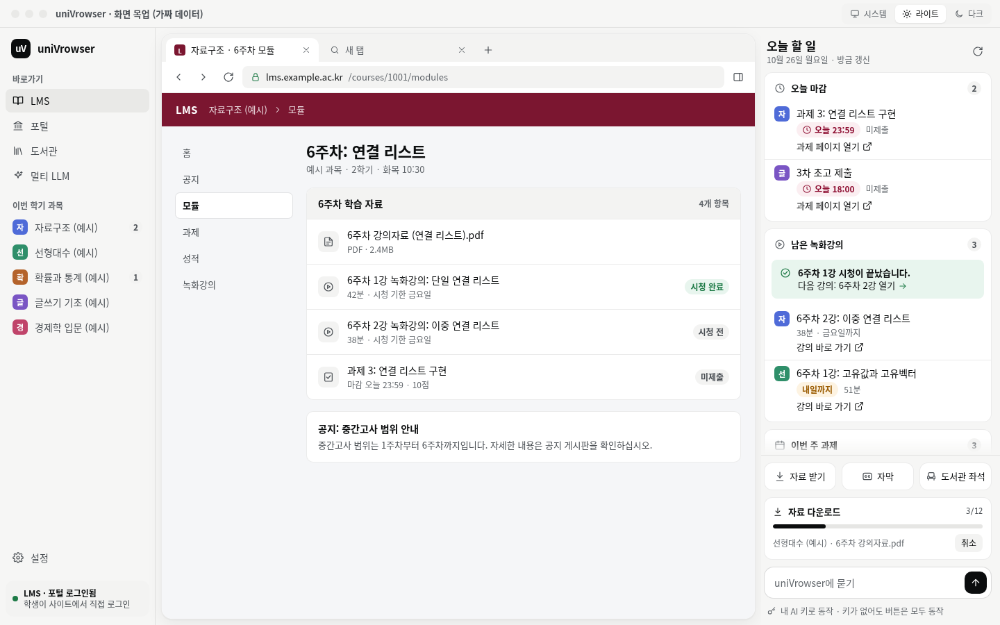

# uniVrowser

고려대학교 학생을 위한 데스크톱 브라우저 앱입니다. 지금은 설계 단계이며, 이 저장소에는 기능 설명과 화면 목업만 있습니다.

## 무엇인가

uniVrowser는 LMS, 포털, 도서관 같은 학교 사이트를 한 창에서 쓰게 해 주는 데스크톱 앱입니다. 학생은 가운데 화면에서 실제 학교 사이트에 직접 로그인합니다. 오른쪽 좁은 패널은 오늘 마감되는 과제, 남은 녹화강의, 새 공지를 모아서 보여 주고, 항목마다 해당 페이지로 가는 링크를 붙입니다. 앱은 정보를 조회하고 정리하는 일만 하며, 학교 사이트의 내용을 바꾸는 동작은 하지 않습니다.

## 화면 구성

[목업 직접 열기](https://leetae9yu.github.io/uniVrowser/mockup.html)

목업은 가짜 데이터로 그린 화면입니다. 과목 이름, 과제, 공지는 모두 예시이며 실제 정보가 아닙니다. 목업의 제목 표시줄에서 라이트, 다크 테마를 바꿀 수 있고, 탭을 누르면 새 탭 화면을 볼 수 있습니다.

| 영역 | 내용 |
| --- | --- |
| 왼쪽 사이드바 | 학교 서비스 바로가기(LMS, 포털, 도서관, 멀티 LLM)와 이번 학기 과목 목록을 둡니다. |
| 가운데 화면 | 실제 학교 사이트를 띄웁니다. 탭과 주소창이 있는 일반 브라우저 화면입니다. |
| 오른쪽 패널 | 오늘 할 일 카드, 자료 받기와 자막과 도서관 좌석 버튼, 작업 진행 표시, 질문 입력창을 둡니다. |
| 새 탭 | 입력창 하나를 두 모드로 씁니다. 사이트 검색 모드는 주소나 검색어를 엽니다. uniVrowser에 묻기 모드는 질문을 조회로 바꿔서 답합니다. |

## 기능

### 조회

LMS에서 과목, 과제와 마감, 할 일, 공지, 게시판, 성적, 강의계획서를 조회합니다. 포털에서 학교 공지, 장학 공지, 학과 공지, 시간표를 조회합니다. 과제 카드에는 과제 페이지로 가는 링크만 있고, 제출 버튼은 없습니다.

### 자료 정리

과목별 강의자료를 한 번에 내려받아 과목과 주차별 폴더로 정리합니다. 진행 상황은 전체 파일 수 중 받은 파일 수로 보여 줍니다(예: 3/12).

### 녹화강의 알림과 바로가기

아직 보지 않은 녹화강의가 있으면 알려 주고, 그 강의로 가는 링크를 줍니다. 학생이 강의 하나를 다 보면 다음 강의로 가는 링크를 알려 줍니다. 앱은 LMS의 출석과 진도 조회 결과로 시청 여부를 판단합니다. 앱은 강의를 자동으로 재생하지 않습니다.

### 자막

강의에 공식 자막이 있으면 앱이 그 자막을 받아서 텍스트 파일로 저장합니다.

### 음성 받아쓰기(STT)

공식 자막이 없는 강의는 음성을 받아써서 텍스트로 만듭니다. 받아쓰기에는 학교가 제공하는 AI API를 학생 본인의 키로 씁니다. 음성이 길면 앱이 여러 조각으로 나누어 보내고, 받은 결과를 하나로 합칩니다.

### 도서관

열람실별 남은 좌석 수를 조회합니다. 앱은 좌석을 예약하지 않습니다.

### 학사일정

월별 학사일정을 조회합니다. 시간표는 달력 앱에서 쓰는 파일로 내보낼 수 있습니다.

### AI 도우미(BYOK)

학생이 본인 AI 키를 넣으면 "이번 주에 마감되는 과제 알려 줘" 같은 질문을 할 수 있습니다. AI는 질문을 앱의 조회 기능 호출로 바꾸는 일만 하고, 실제 조회는 앱 코드가 수행합니다. 답에는 해당 페이지 링크를 붙입니다. 질문 범위는 학업 도우미 용도로 제한합니다. AI 키가 없어도 모든 기능을 버튼으로 쓸 수 있습니다.

## 하지 않는 것

- 과제 제출, 수강 신청, 게시글 작성처럼 학교 서버의 상태를 바꾸는 기능은 만들지 않습니다. 앱은 해당 페이지 링크까지만 보여 줍니다. 학생은 가운데 화면의 실제 사이트에서 직접 제출합니다.
- 학교 비밀번호를 저장하지 않습니다. 학생은 실제 사이트 화면에서 직접 로그인합니다.
- AI가 학생 대신 사이트를 클릭하거나 입력하지 않습니다.
- AI 서비스를 부를 때 공식 API만 씁니다. 웹 화면의 내부 통로는 쓰지 않습니다.

## 데이터와 보안 원칙

- 앱은 조회 요청만 보냅니다. 앱의 요청 계층은 읽기 요청과 로그인 요청이 아니면 거부합니다.
- 로그인 세션 자료와 AI 키는 운영체제 키체인으로 암호화해서 학생 컴퓨터에만 저장합니다.
- 가운데 화면에 뜬 사이트는 앱 내부 기능에 접근할 수 없습니다.
- 조회 결과는 학생 컴퓨터에서 처리하며, 개발자 서버로 보내지 않습니다. AI 기능을 쓸 때에만 질문과 필요한 조회 결과가 학생 본인의 키로 AI API에 전달됩니다.
- 기록 파일에 남기는 내용에서는 학번, 이름, 토큰 같은 개인정보를 가립니다.

## 로드맵

1. 데스크톱 앱(macOS, Windows): 조회, 자료 정리, 녹화강의 알림, 자막과 STT, 도서관, 학사일정, AI 도우미를 만듭니다.
2. 모바일 앱: 데스크톱 앱과 같은 조회 엔진을 다시 씁니다. 모바일 화면은 좁으므로, 오늘 할 일 화면과 앱 안의 웹 화면을 오가는 구조로 만듭니다. 마감 알림은 모바일 푸시와 함께 다룹니다.

## 현재 상태

설계 단계이며, 코드는 아직 없습니다. 이 저장소에는 기능 설명과 화면 목업만 있습니다.
